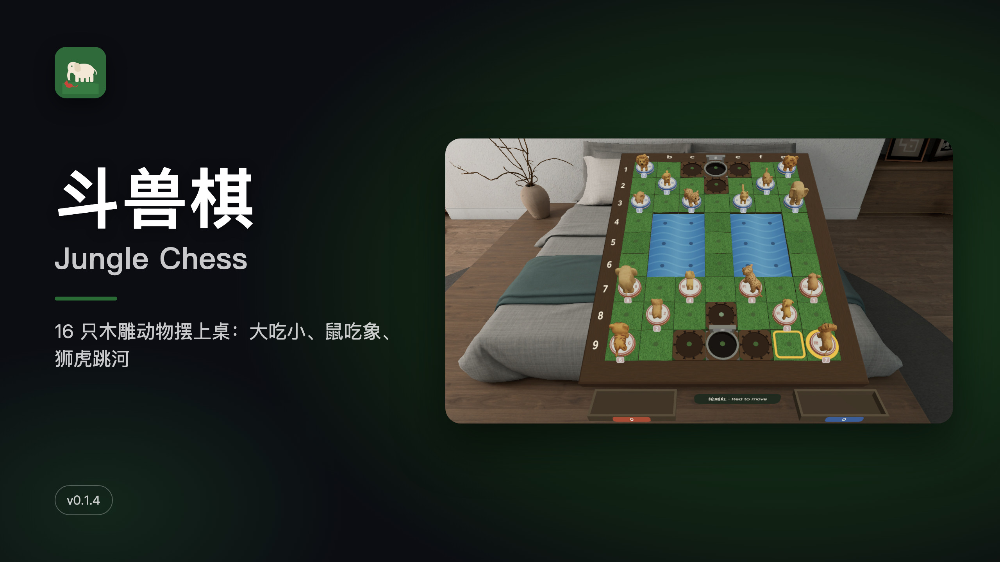
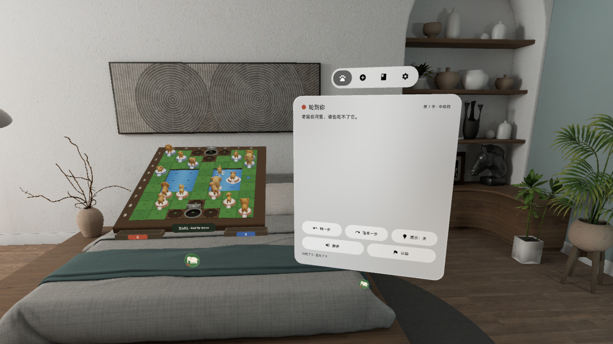
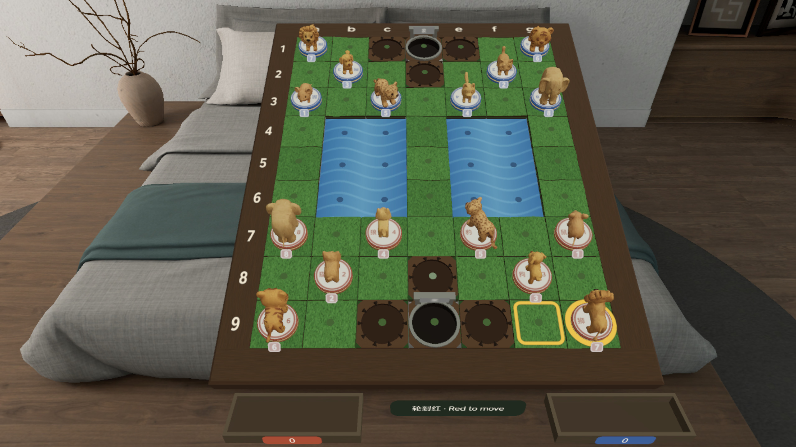
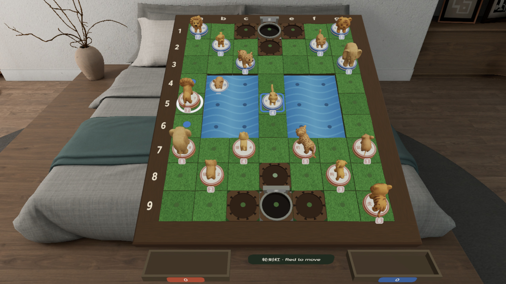
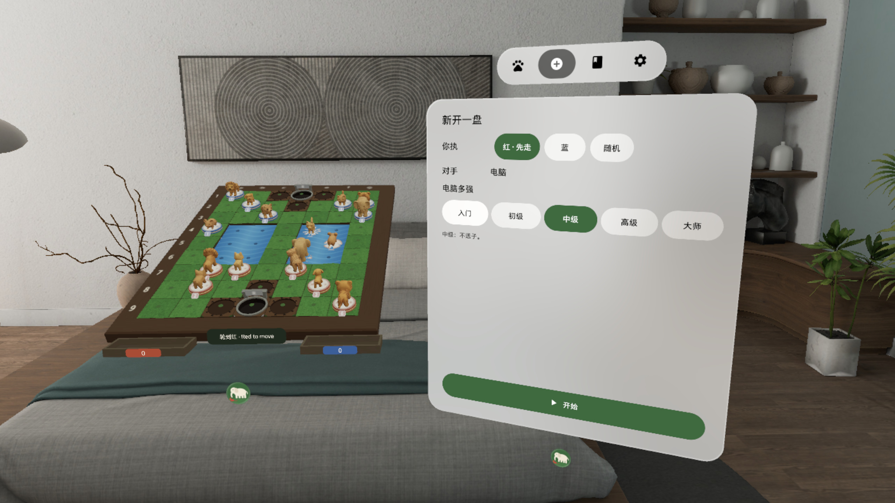
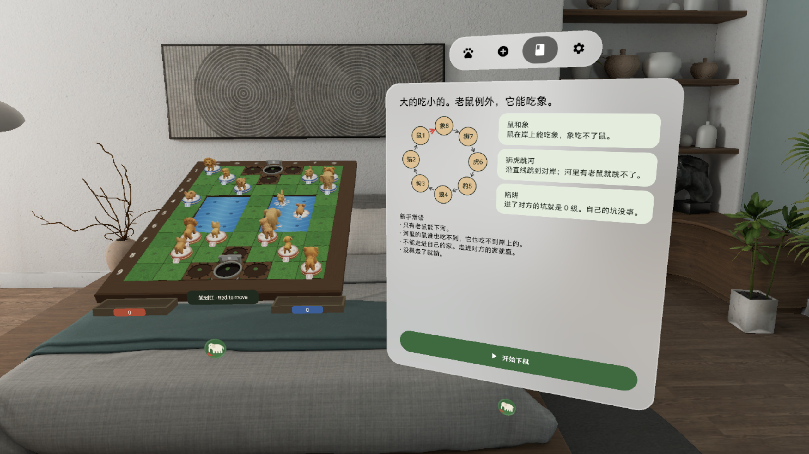
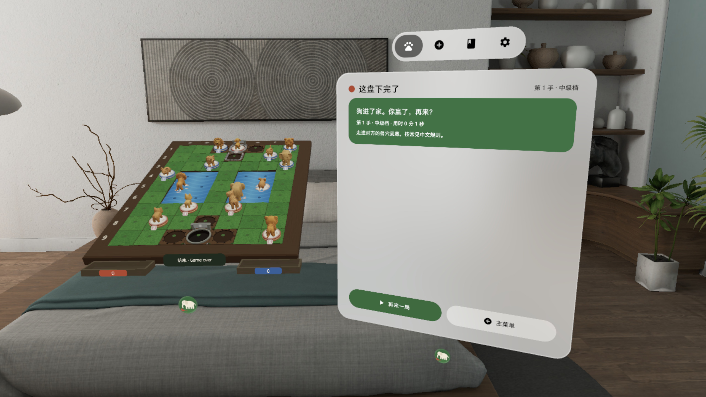

# 斗兽棋 Jungle Chess



[中文](#中文) · [English](#english)

---

## 中文

**桌上摆一副立体斗兽棋：16 只木雕动物，大吃小、鼠吃象、狮虎跳河，五档电脑陪你下。**

PICO 空间应用（PICO OS 6 · Spatial SDK BOM 6.1.9 · Shared Space 体积窗口）。一块 7 × 9 的草地棋盘摆在你面前：两条河、六个陷阱、两个兽穴，象、狮、虎、豹、狼、狗、猫、鼠十六只小木雕动物站在格子上。规则就是小时候下的那套：大吃小，老鼠能吃大象；狮子和老虎能跳河，河里有老鼠就跳不过去；进了对方的兽穴就赢。

### 能做什么

- **点子先看走法**：点自己的动物，它抬起来，能走的格子都亮出来——蓝点是空格，橙框是能吃，狮虎跳河的对岸单独标出；再点目标格就走，也可以直接拖过去
- **走错了说为什么**：非法的一步子不动，控制窗一句话说原因（比如「老鼠在河里，大象吃不到它」）
- **五档电脑**：入门 / 初级 / 中级 / 高级 / 大师，本机 α-β 搜索；入门档没下过的人也能赢；悔一步、重来一步、提示、认输、重开；同一局面出现三次判和
- **看得见的吃子**：被吃的动物放进棋盘前的托盘；鼠吃象时大象倒下，进陷阱的动物趴下
- **真实的声音**：落子、跳河、倒下、进陷阱是 Kenney CC0 木头撞击录音，八种动物叫声和落水声是 freesound CC0 录音，每种 3 个变体轮换；选子不出声
- **系统原生窗口**：棋盘在系统立体窗口里，用下方系统把手拖动；控制窗（对局 / 新局 / 规则 / 设置）在棋盘右边，随时重开
- 手柄射线、手势射线、眼手捏合都能点子；每步自动存档；中英双语；本机运行，不联网、不要账号

### 截图

> v0.1.4 截图来自 PICO 模拟器（画质高清 2560，中文界面），由调试广播驱动，**非真实手势录像**。演示视频 `video-01.mp4`（55 秒，无声）在 Release 资产里，同样是**非真实手势录像**。

| | |
|---|---|
|  真实房间里：棋盘摆在面前，右边是控制窗 |  开局：十六只木雕动物；提示打开时黄框标出建议的一步 |
|  选中狮子：蓝点是能走的格子，河对岸的蓝狼可以跳河吃掉 |  新开一盘：执红 / 执蓝 / 随机，电脑五档 |
|  规则页：一张食物链图 + 三条特殊规则 |  赢了：狗走进对方兽穴 |

### 安装

[Release v0.1.4](https://github.com/kejing-dev/JungleChess/releases/tag/v0.1.4) 里有两个 APK：

- `JungleChess-v0.1.4-debug.apk`：头显上实测的那个 debug 包，可以直接装
- `JungleChess-v0.1.4.apk`：`assembleRelease` 出的未签名包（给应用商店上架用，`adb install` 会拒绝）

头显开启开发者模式，USB 连上电脑：

```bash
adb install -r JungleChess-v0.1.4-debug.apk
pico-cli app launch io.embodit.junglechess
```

或从源码构建：`./gradlew assembleDebug`，再 `adb install -r app/build/outputs/apk/debug/app-debug.apk`。

需要 PICO OS 6（Android 15，minSdk 35）。不需要额外权限。

### 已知问题

1. 模拟器 QA 第 2 轮在 v0.1.2 上已过；v0.1.3–v0.1.4 是真机反馈修复（三种输入的命中解析、hover 标记、CC0 录音、选子无声），由用户戴头显看过后放行，没有再跑一轮模拟器 QA。
2. 手柄射线在真机上是以手柄还是手势射线的来源进应用，还没完全查实（v0.1.4 的输入日志已多打 `kind=`，下一轮能分清）。
3. 规则按标准斗兽棋：狮、虎能跳河，豹不能跳；没有「豹横跳」等地方变体。
4. 系统 TabBar 只显示图标、不显示文字（平台限制）。
5. 「对方在想…」只有文字，没有转圈；选中的动物会挡住身后合法格的一半蓝点。
6. 双人同机、残局、回放 / 棋谱导入导出、木色皮肤在下个版本。

### 版本历史

- **v0.1.4**：真机反馈「三种输入都点不动棋子」→ 修好棋子命中解析（动物、底座、碰撞体都对到正确格子），加命中目标 → 格子回放单测；系统 hover 挂到每格可见小标记上；叫声、落水声全部换成 CC0 录音；选子无声
- **v0.1.3**：输入层换成工厂通用棋盘输入模板（短拖当点击、按父节点找命中、盘面命中换算格子）；落子声换成 Kenney CC0 木头撞击录音，hover 高亮
- **v0.1.2**：退出时关掉棋盘体积和控制窗；对局中开新局先确认；首次打开就摆好开局
- **v0.1.1**：控制窗 640 dp 不再切字；等级小牌；动物按等级等比缩放；AI 可取消；重复局面判和
- **v0.1.0**：首个版本，规则引擎、五档 AI、草地棋盘、Tripo 木雕动物、控制窗

### 许可与素材

- 字体：Noto Sans（SIL OFL 1.1，见 `third_party/`）
- 音效：Kenney Impact Sounds（kenney.nl，CC0 1.0）；动物叫声 / 落水 / 滴水为 freesound.org 上标明 CC0 的录音，逐条来源见 `tools/asset-pipeline/freesound-sources.json`
- 八种动物模型由 Tripo 生成，经 `tools/asset-pipeline/animals.mjs` 减面到 ≤ 2k 三角；棋盘、底座、托盘由 `board.mjs` 生成
- 本仓库公开；用 Claude Code 在「黑灯工厂」产线上研发（Claude Opus 5.5 研发 / QA / 发布，Claude Fable 5.1 调研 / 设计）
- 开发结构、调试命令见 [AGENTS.md](AGENTS.md)

---

## English

**A 3D Jungle Chess set on your table: 16 carved wooden animals — big eats small, the rat eats the elephant, lions and tigers leap the river — against five computer levels.**

A PICO spatial app (PICO OS 6 · Spatial SDK BOM 6.1.9 · Shared Space volume). A 7 × 9 grass board sits in front of you with two rivers, six traps and two dens; sixteen small wooden animals — elephant, lion, tiger, leopard, wolf, dog, cat and rat — stand on the squares. Classic Dou Shou Qi rules: higher rank captures lower, but the rat can take the elephant; lions and tigers jump across the river unless a rat is in the way; enter the opponent's den to win.

### Features

- **See your moves first**: tap one of your animals and it lifts; every legal square lights up — blue dots for empty squares, orange frames for captures, a separate mark for the far bank of a river leap. Tap the target to move, or just drag the animal there
- **Illegal moves explained**: the piece stays put and the control window says why in one sentence
- **Five computer levels**: Beginner / Easy / Normal / Hard / Master, local alpha-beta search; Beginner is beatable by first-time players; undo, redo, hint, resign, restart; a position repeated three times is a draw
- **Captures you can see**: captured animals go to trays in front of the board; the elephant topples when a rat takes it, animals crouch in traps
- **Real sounds**: piece, leap, topple and trap sounds are Kenney CC0 wood impacts; the eight animal cries and the splash are CC0 recordings from freesound, three variants each; selecting is silent
- **Native system windows**: the board lives in a system volume — move it with the system handle; the control window (Play / New game / Rules / Settings) sits to its right and can be reopened anytime
- Controller ray, hand ray and eye-hand pinch all work; autosave every move; Chinese and English; fully offline, no account

### Screenshots

> v0.1.4 PICO emulator screenshots (high-definition 2560, Chinese UI), driven by debug broadcasts — **not a recording of real hand input**. The demo video `video-01.mp4` (55 s, no sound) is a Release asset, also **not real hand input**.

| | |
|---|---|
|  In a real room: the board in front of you, the control window on the right |  Opening position; with hints on, a yellow frame shows the suggested move |
|  Lion selected: blue dots are legal squares; it can leap the river and take the blue wolf |  New game: play red / blue / random, five computer levels |
|  Rules: one food-chain diagram and three special rules |  Win: the dog walks into the opponent's den |

### Install

[Release v0.1.4](https://github.com/kejing-dev/JungleChess/releases/tag/v0.1.4) has two APKs:

- `JungleChess-v0.1.4-debug.apk`: the debug build tested on the headset — install this one
- `JungleChess-v0.1.4.apk`: an unsigned `assembleRelease` build (for store submission; `adb install` rejects it)

Enable developer mode on the headset and connect it over USB:

```bash
adb install -r JungleChess-v0.1.4-debug.apk
pico-cli app launch io.embodit.junglechess
```

Or build from source: `./gradlew assembleDebug`, then `adb install -r app/build/outputs/apk/debug/app-debug.apk`.

Requires PICO OS 6 (Android 15, minSdk 35). No extra permissions.

### Known issues

1. Emulator QA round 2 passed on v0.1.2; v0.1.3–v0.1.4 are fixes from on-headset feedback (hit resolution for all three input sources, hover markers, CC0 recordings, silent selection) and were approved after the user tried them on a headset, without another emulator QA round.
2. Whether the controller ray reaches the app as a controller or as a hand ray on the headset is not fully confirmed yet (v0.1.4 logs `kind=` to tell them apart).
3. Standard rules: lions and tigers leap the river, the leopard does not; no regional variants.
4. The system TabBar shows icons only, no labels (platform limitation).
5. "Thinking…" is text only, no spinner; the selected animal hides half of the blue dots behind it.
6. Hot-seat two-player, puzzles, replay / notation import-export and wood skins come in the next version.

### History

- **v0.1.4**: headset feedback "none of the three inputs can pick a piece" → fixed piece hit resolution, added hit-target → square replay tests; system hover drawn on visible per-square markers; animal cries and splash replaced with CC0 recordings; silent selection
- **v0.1.3**: input layer moved to the factory board-input template (short drags count as taps, parent-chain hit resolve, board-surface hits); Kenney CC0 wood impacts; hover highlight
- **v0.1.2**: exit closes both the board volume and the control window; starting a new game over a running one asks first; the opening is set up on first launch
- **v0.1.1**: 640 dp control window, rank tags, uniform animal scale, cancellable AI, repetition draw
- **v0.1.0**: first version — rules engine, five-level AI, grass board, Tripo wooden animals, control window

### License and assets

- Font: Noto Sans (SIL OFL 1.1, see `third_party/`)
- Sounds: Kenney Impact Sounds (kenney.nl, CC0 1.0); animal cries / splash / drip are CC0-marked recordings from freesound.org, sources in `tools/asset-pipeline/freesound-sources.json`
- The eight animal models were generated with Tripo and reduced to ≤ 2k triangles by `tools/asset-pipeline/animals.mjs`; board, bases and trays come from `board.mjs`
- This repository is public; developed with Claude Code on the "dark factory" pipeline (Claude Opus 5.5 for build / QA / release, Claude Fable 5.1 for research / design)
- Code structure and debug commands: [AGENTS.md](AGENTS.md)
